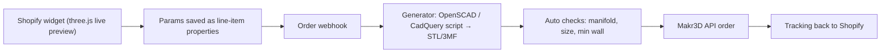

# Vibe Manufacturing: Product Ideas & Niche Research Plan

## 0. Constraints from the fulfilment side (Makr3D, read 19 Oct 2026)

From [makr3d.app/how-it-works](https://makr3d.app/how-it-works):
- UK Bambu print farm (Huddersfield). Flow: upload file → auto-quote → **test print** → sell → they print, QA, pack, ship (dropship or bulk).
- **Materials live: PLA & PETG only** (resin "planned").
- Integrations: **Etsy, Shopify**, plus an **API & webhooks**. This matters most for auto-generated custom STLs per order.
- White-label packaging is available.

**What this means for your designs:**
| Constraint | Design rule |
|---|---|
| FDM PLA/PETG | No fine resin detail. Aim for chunky, functional, parametric shapes. Text ≥ 1 mm stroke, relief ≥ 0.6 mm |
| PLA softens ~55–60 °C, PETG ~75–80 °C | Nothing touching hot surfaces (group heads, dashboards in summer, dishwashers) unless it's PETG and you've tested it |
| Layer lines trap bacteria | **Do not claim food-safe.** Keep products for handling, storage, display or holding, not direct food contact |
| Per-order custom STL | Product must be **parametric** (text, dimensions, logo, shape options) so a script (OpenSCAD / CadQuery / build123d) produces the STL with no manual CAD |
| UK origin | Shipping cost and time favour UK/EU buyers first. Price for international shipping |

---

## 1. Product ideas (all parametric, all FDM-friendly)

Scoring: **Spend** = how much the niche already spends on its main gear. **Custom** = how much personalisation adds real value (fit or identity) beyond a novelty name.

### A. Hobbyist gear accessories (the "r/espresso" pattern)
| Idea | Customisation parameter | Spend | Custom |
|---|---|---|---|
| Espresso **dosing funnel / WDT tool stand / tamper station** | Basket diameter (51/54/58 mm), machine model, name/logo | High | Fit + identity |
| **Puck screen & tool organiser** for a specific grinder footprint | Grinder model (Niche, DF64, EK43), tool slots chosen | High | Fit |
| **Mechanical keyboard** keycap display stand, wrist-rest frame, case feet | Board layout (60/65/75/TKL), name, angle | High | Fit |
| **Synth / Eurorack** blank panels, knob caps, controller stands | HP width, jack layout, labels | High | Fit + function |
| **Guitar pedalboard** risers, cable clips, patch labels | Pedal list/sizes, board model | High | Fit |
| **Film camera** lens caps, hot-shoe covers, film canister holders | Camera mount, film stock label | Med–High | Identity |
| **Fountain pen** stands, ink bottle trays | Pen count, bottle model | Med–High | Fit + identity |
| **Disc golf** mini markers, bag tags, disc wall racks | Name, PDGA number, club logo | Med | Identity |
| **Fishing** lure boxes, rod holders for specific kayak rails | Rail model, lure sizes | Med–High | Fit |

### B. Fit-to-your-exact-device (the strongest moat: generic products don't fit)
- **Gridfinity bins** generated from a photo or list of your tools. Huge maker community, and people pay to skip the CAD work.
- **Under-desk mounts** for a specific power brick, hub or dock (enter the model and get the exact cradle).
- **Wall mounts** for Dyson / Shark / Miele vacuums, Starlink router, Steam Deck, Switch 2, controllers.
- **Drawer inserts** sized to the user's drawer (W×D×H) with a slot layout they choose.
- **Replacement knobs, clips and feet** for discontinued appliances (parametric shaft diameter / D-cut).

### C. Identity / fandom / gifting
- **Custom lithophanes** (photo → lamp shade / night light). Proven gift seller.
- **Topographic maps**: race route, hiking trail, home town, wedding venue. Strong with runners, cyclists and Strava users ("your marathon in 3D").
- **Race medal / bib hangers** with name, races and PBs.
- **Pet** name bowls stands, urn-style memorial plaques, lead hooks.
- **Club / team** branded items for local sports clubs, run clubs and D&D groups. This is B2B bulk via Makr3D.
- **Tabletop gaming**: custom dice towers, initiative trackers, army transport trays sized to the user's miniatures, card deck boxes sized to sleeve brand.

### D. Small business / B2B ("customisation-as-a-service")
- **Café / barber / salon** branded counter signs, QR stands, card holders.
- **Etsy and Shopify sellers** who want branded product stands or packaging inserts.
- **Real estate agent** branded key fobs and house-shaped keyrings (closing gifts).
- **Wedding** cake toppers, place-card holders, table numbers. Seasonal, but high average order value.

### Top 5 to test first (my picks)
1. **Espresso dosing / station kit by basket size + engraved name.** This is the video's own example, and it's a niche with clear high spend.
2. **Strava/GPX → 3D route trophy.** The customer uploads a file, the item is personal, and it sells well as a gift.
3. **Gridfinity / drawer inserts to exact dimensions.** Fit-based, so it repeats well, and you can automate it with a script.
4. **Device-specific wall/desk mounts** (enter model → STL). This also gives you SEO long-tail pages per model.
5. **Tabletop deck boxes / army trays sized to user's collection.** Spending in this community is very high and personal attachment is strong.

---

## 2. Research plan: finding niches that sell

### Phase 1: Demand discovery (week 1)
Goal: list 30+ candidate niches with evidence of spend and of "I wish this existed".

| Source | What to search / measure |
|---|---|
| **Reddit** (r/espresso, r/MechanicalKeyboards, r/synthesizers, r/fountainpens, r/discgolf, r/Gridfinity, r/minipainting, r/boardgames, r/running) | Search `"3d printed"`, `"does anyone make"`, `"I wish"`, `"custom"`, `"where can I buy"`. Record upvotes and comment counts |
| **Printables / MakerWorld / Thingiverse** | Sort by downloads/likes per category. High downloads + "remix" requests for other sizes = **demand for parametric version** |
| **MakerWorld "Parametric Model Maker"** | Which customizers get the most use. That's direct proof of customisation demand |
| **Etsy** | Search "custom 3D printed ___". Use eRank / EverBee / Alura for monthly sales estimates, review counts, price bands |
| **Amazon** | Accessory listings for the target gear: review complaints about fit ("didn't fit my X") are opportunities |
| **Google Trends / Keyword Planner / Ahrefs** | Search volume for "[device] mount", "[gear] accessory". Look for long-tail model-specific queries |
| **TikTok / YouTube Shorts** | `#3dprinting` + niche tag. Videos with high views/shares where the comments say "where can I get one" |

### Phase 2: Scoring (week 1–2)
Score each niche 1–5 and keep the top 5:

| Criterion | Question |
|---|---|
| **Gear spend** | Is the main hobby purchase over £300? |
| **Identity** | Do people post their setup ("battlestation", "coffee station", "pedalboard")? |
| **Fit pain** | Do generic accessories fail because of model or size variation? |
| **Parametric-able** | Can 1–5 inputs fully define the STL? |
| **FDM-safe** | No heat, food-contact or tiny-detail requirements? |
| **Competition** | Fewer than ~20 Etsy sellers offering *customised* versions? |
| **Price headroom** | Can it retail at 3–5× the fulfilment quote? |
| **Community access** | Is there a sub, Discord or forum where you can show it without being banned? |

### Phase 3: Unit economics (week 2)
1. Generate one base STL per top-5 product.
2. Run each through **Makr3D instant quote** (and one competitor for comparison, e.g. JLC3DP, Craftcloud, or a local farm).
3. Add packaging, shipping, Etsy/Shopify fees (~10–15%), ad cost per acquisition estimate.
4. Keep only products with **≥ 50% gross margin** at a price that matches Etsy comparables.

### Phase 4: Validate before building the customizer (week 2–3)
- **Fake-door test:** a Shopify page with mockup renders + "Pre-order / notify me", with £50–100 of Meta/Reddit ads targeted at the niche. Measure CTR and email signups.
- **Community post:** a "made this for my setup, would anyone want one with their name / size?" post on the relevant subreddit. Count DMs and comments.
- **Test print:** order a Makr3D test print and photograph it for real listing imagery.
- Kill rule: under ~2% click-through to the "customise" button, or no inbound requests → drop the niche.

### Phase 5: Build the customizer pipeline (week 3–5)

- Start with **OpenSCAD or CadQuery** templates. The AI writes the template once; the inputs are fixed fields, never free-form AI geometry, so every STL is printable.
- Live preview: render the same params client-side (three.js + a pre-generated mesh, or OpenSCAD-WASM).
- Before the API flow, check the [Makr3D API docs](https://makr3d.app/help/api) to see whether it accepts per-order files (needed for one-off customs) or only pre-registered products.

### Phase 6: Scale & B2B (month 2+)
- Add model-specific SEO pages (one per device or basket size).
- Pitch the widget to existing Shopify stores in the niche (espresso retailers, keyboard vendors) as a white-label "customise your accessory" add-on with a revenue share.

---

## 3. Deliverables to track
- [ ] Niche longlist spreadsheet (30+ rows, Phase 1 evidence links)
- [ ] Scored shortlist (top 5)
- [ ] Unit-economics sheet with real Makr3D quotes
- [ ] 2 fake-door tests run, with results
- [ ] 1 parametric template + test print in hand
- [ ] Shopify widget MVP → webhook → STL → fulfilment proven end-to-end with 1 real order

> [!WARNING]
> Watch IP. Don't use brand logos (La Marzocco, Pokémon, sports teams) without a licence. "Compatible with [Model]" wording is generally fine; using their trademarks as decoration is not.
